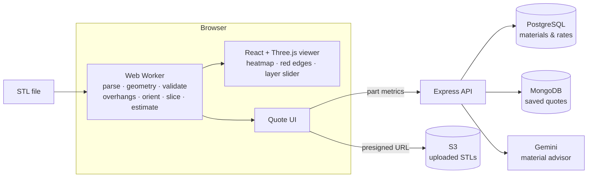
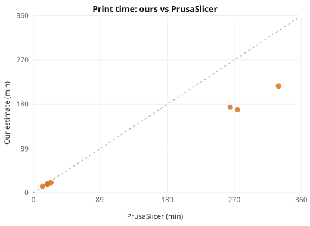
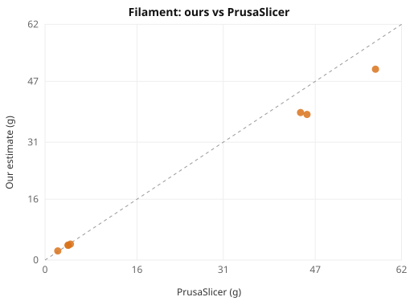

# Manufacturing Quote Engine

Upload an STL, inspect it in 3D, and get an instant quote for **3D printing and CNC machining**. The geometry engine, the mesh checks and a mini slicer are written from scratch and checked against **PrusaSlicer**, the slicer real print shops use.

**Live demo:** _add your Vercel link_ · **Stack:** React (Vite), Three.js / react-three-fiber, Web Workers, Node/Express, PostgreSQL, MongoDB, Gemini API, AWS S3, Vitest, GitHub Actions, Docker

<!-- Add a 60-second demo GIF here: docs/demo.gif -->

## What it does

- **Parses STL by hand** (binary and ASCII): 80-byte header, triangle count, 50 bytes per triangle
- **Geometry:** volume (signed tetrahedron sum), surface area, bounding box, center of mass
- **Mesh validation:** welds vertices, builds an edge map and finds holes, non-manifold edges, flipped faces and zero-area triangles, drawn in red in the viewer
- **Automatic repair:** removes zero-area triangles, makes neighbouring faces agree (walks the mesh and flips mismatches), turns inside-out parts right side out, and closes holes by following their open edges and fanning them shut. Repaired faces are shown in green
- **Wrong units:** a part only a few mm across was probably modelled in inches, cm or metres; one click rescales it
- **Printers:** pick a preset (Prusa MK4 / Core One, Bambu P1S / A1 mini, Ender 3 V3 SE) or add your own (build size, nozzle, speed class, enclosure, hourly rate, saved in the browser). The printer changes the print time, the machine rate, the minimum wall thickness (2 × nozzle) and the fit check, and a compatibility card flags ABS on open-frame printers
- **Printer fit:** checks the part against the chosen printer's build volume, and if it only fits on its side, finds the lowest orientation that fits
- **Thin walls:** casts a ray inward from every face to measure local wall thickness (grid-accelerated Möller–Trumbore) and paints walls thinner than 2 × the nozzle red
- **Overhangs:** faces steeper than 45° turn red; support volume is estimated by projecting them down to the build plate
- **Auto-orientation:** tries 26 "up" directions and picks the one with the least support and height
- **Mini slicer:** cuts every layer with a plane, stitches the segments into closed loops and shows them on a layer slider
- **Estimates:** print time and filament from the sliced paths (with acceleration), CNC time from stock removal and setups
- **Pricing:** material + machine time + setup, with rates in a PostgreSQL table so a shop could set its own; quantity discounts (5–20 %) and a minimum order value
- **Locked quotes:** saving sends the actual mesh to the server, which re-runs the same geometry engine and prices it itself, then stores the quote with an ID (`Q-XXXXXXXX`) and a 30-day expiry. A checkout calls `GET /api/quotes/:id` and charges that total, never a price from the browser
- **AI material advisor:** describe the use ("outdoor bracket holding 5 kg"); Gemini must answer with JSON that is checked against the materials table
- **Quote history** (MongoDB): each browser only sees the quotes it saved (the full list needs an admin token), **PDF quote**, optional **S3** storage of uploads
- **Rate limits** per IP on every API route, and all printer values from the browser are clamped on the server
- All heavy work runs in a **Web Worker**, so the page stays responsive on large files

## Architecture



The browser does the geometry, so the page is instant and the server stays light. When a quote is saved, the server runs the **same engine** (`client/src/engine`, shared code) on the uploaded mesh, so a locked price can't be tampered with.

## How the core works

**Volume of any closed mesh.** Every triangle (a, b, c) forms a tetrahedron with the origin, with signed volume `a · (b × c) / 6`. Faces pointing away from the origin add, faces pointing toward it subtract, so the sum is the enclosed volume even for non-convex parts and parts with internal cavities. That's why the mesh must be watertight.

**Watertight check.** STL repeats each corner for every triangle, so corners are first welded (rounded to 0.0001 mm and hashed). In a closed mesh every edge is used by exactly two triangles, walked in opposite directions. Used once means a hole, three or more times means non-manifold, and the same direction twice means a flipped face.

**Slicing.** At each layer height, every triangle crossing the plane gives one segment. Each segment is pointed so the solid is on its left (from the face normal), so outer walls run counter-clockwise and holes clockwise. Hashing segment end points lets the code walk from segment to segment into closed loops. The shoelace formula then gives each layer's area, with holes subtracting automatically.

**Print time.** Walls are traced along the actual loops, split at sharp corners (the printer keeps speed through gentle bends), and each run is timed with a trapezoidal speed profile at 1500 mm/s². Infill and top/bottom skin lengths come from area ÷ line spacing. Speeds, cooling slowdown and retraction match PrusaSlicer's default printer profile.

## Results

Tested against PrusaSlicer 2.7 with the "Generic" printer profile and the same settings (0.2 mm layers, 20 % infill, 2 walls, 4 top/bottom layers, PLA, no supports). How to rerun: [`eval/README.md`](eval/README.md).

| Model | Triangles | Watertight | Ours (min) | PrusaSlicer (min) | Time error | Ours (g) | PrusaSlicer (g) | Filament error | Analyze + slice |
|---|---:|:---:|---:|---:|---:|---:|---:|---:|---:|
| cube20 | 12 | ✓ | 17.4 | 18.8 | -7.7% | 3.9 | 4.02 | -2.2% | 7 ms |
| hollow_cube | 24 | ✓ | 20.3 | 23.6 | -13.7% | 4.2 | 4.42 | -5% | 4 ms |
| sphere_r10 | 2,208 | ✓ | 13.1 | 12.2 | 7.6% | 2.4 | 2.22 | 6.9% | 8 ms |
| pumpkin_1 | 330,708 | ✗ | 169 | 274.4 | -38.4% | 38.3 | 45.56 | -15.9% | 1307 ms |
| pumpkin_2 | 187,626 | ✗ | 216.7 | 329.4 | -34.2% | 50.2 | 57.47 | -12.7% | 906 ms |
| pumpkin_3 | 357,496 | ✗ | 173.8 | 264.6 | -34.3% | 38.8 | 44.44 | -12.8% | 1220 ms |

_Preliminary (6 models). Replace with the full 30-model run from `eval/results.md`._

 

**Why the estimates differ.** Simple prismatic and smooth parts land within about 8 % on time and 2–7 % on filament. Detailed organic models are underestimated, because PrusaSlicer adds material and moves this engine does not model:
- **Extra perimeters and vertical shell thickness:** on sloped and curved walls PrusaSlicer adds perimeters and solid infill to keep the shell thick. This is the main reason filament is 13–16 % low on the pumpkins.
- **Gap fill and Arachne variable-width walls:** thin features get extra, slow (20 mm/s) gap-fill moves.
- **Motion planning:** PrusaSlicer simulates jerk and junction speed move by move. This engine uses a simplified corner model, accurate for clean geometry but not for meshes with hundreds of thousands of tiny facets.
- **Travel and retraction** are estimated per loop, not planned.

**Speed:** a 357k-triangle (18 MB) STL is parsed, validated and sliced into 374 layers in about 1.2 s.

## Tests

```bash
cd client && npm test   # 49 tests: printers, parser, geometry, validation, repair, units, printer fit, thin walls, overhangs, orientation, slicer, estimates, STL export
cd server && npm test   # 14 tests: pricing, discounts, minimum order, server-side re-verification, printer rates and limits, quote IDs and expiry, rate limiting
```

Ground truth comes from shapes with known answers: a 20 mm cube (8000 mm³, 2400 mm²), a hollow cube (7000 mm³, cavity subtracts), a faceted sphere (within 1 % of 4/3·π·r³), plus broken meshes (missing triangle, flipped triangle, zero-area triangle). CI runs both suites and the Docker build on every push.

## Limitations

- STL has no units; millimeters are assumed.
- Non-watertight meshes give approximate volumes (a warning is shown).
- Print time is a model, not a toolpath planner: see "Why the estimates differ".
- Support volume is a projection estimate; real support structures differ in shape and density.
- Unit detection is a size heuristic: a genuinely tiny part (a 5 mm gear) will be asked about, and the user decides.
- Thin-wall rays start at face centres, so very thin features smaller than a face can be missed; on self-intersecting meshes overlapping shells can be reported as thin.
- Hole filling uses a fan from the hole's centre: right for small, roughly flat holes, not for large curved gaps.
- CNC time uses one material removal rate per material and ignores tool changes, tool reach and internal pockets the cutter can't reach.
- Prices are illustrative small-shop rates, not real quotes.
- The AI advisor can be wrong; it is limited to materials in the table and always shows its reason.

## Run locally

```bash
# server
cd server
cp .env.example .env      # everything is optional; missing services fall back to defaults
npm install
npm run dev               # http://localhost:5000/api/health

# client (new terminal)
cd client
echo VITE_API_URL=http://localhost:5000 > .env
npm install
npm run dev               # http://localhost:5173
```

## Deploy

- **API (Render):** New → Blueprint → this repo (uses `render.yaml`), then fill in the environment variables. Or build the Docker image from the repo root: `docker build -f server/Dockerfile .` (the server needs the shared engine in `client/src/engine`).
- **Frontend (Vercel):** import the repo, root directory `client`, set `VITE_API_URL` to the Render URL, then add the Vercel URL to `CLIENT_URL` on Render.
- Render's free tier sleeps when idle: the first request can take about 30 s.
